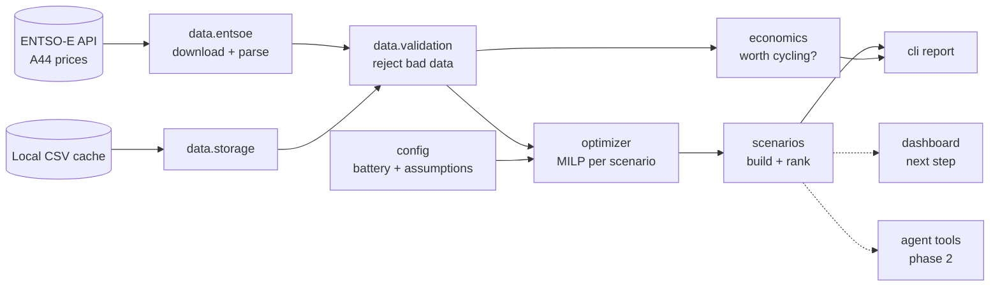

# Technical specification

## Components

| Module | Input | Output | Responsibility |
|---|---|---|---|
| `data.entsoe` | delivery day, API token | raw price series (UTC) | Download and parse; keep the 15-min series; forward-fill A03 curves |
| `data.storage` | CSV path | raw price series | Cache days locally; keep UTC offsets so clock-change days stay unambiguous |
| `data.validation` | raw series | validated series (Europe/Paris) | Reject empty, missing, duplicated, irregular or partial days |
| `config` | — | `BatteryConfig` | One place for every parameter; assumptions marked in code |
| `optimizer` | validated prices, `BatteryConfig` | `Schedule` | Value-maximising schedule, interval by interval |
| `economics` | validated prices, `BatteryConfig` | `CycleCheck` | Best buy/sell pair and its net spread |
| `scenarios` | validated prices, base battery | ranked `ScenarioResult` list | Three parameter sets, one optimisation each, ranking rule |
| `cli` | CSV path or date | text report | What the analyst reads today |

**Contract between modules**: a validated price series is a `pandas.Series`
of floats in EUR/MWh, indexed by the timezone-aware start of each interval in
Europe/Paris, covering exactly one delivery day (96, 92 or 100 intervals).
The optimiser assumes this contract and does no checking of its own.

## Optimisation model

A mixed-integer linear programme per scenario, solved by HiGHS through
`scipy.optimize.milp`. The full formulation is in the docstring of
`src/bess_advisor/optimizer.py`. Size per day: 384 variables (96 binary),
290 constraints; solve time is a fraction of a second.

## Choices challenged during design

Who raised what is stated plainly, because both the author and the AI
assistant proposed things that did not survive review:

- **Solver library** (raised by the assistant): the brief named PuLP; SciPy's
  `milp` ships the same HiGHS solver with no extra dependency.
- **LP vs MILP** (assistant): the textbook formulation is a plain LP. It can charge and
  discharge at the same time on negative-price days, burning energy in losses
  to get paid. A binary variable per interval forbids it.
- **Ranking on revenue** (assistant) would always put the most aggressive scenario first.
  Ranking is on net value (wear and reserve revenue included).
- **15-minute intervals, never hour ranges** (author): a first draft of the
  agent spec summarised the schedule as ranges like "charge 13:00-15:00";
  the analyst needs the exact intervals.
- **Three scenarios on one chart, curtailment, the main test** (author).
- **Scope** (assistant): the first framing implied the tool helps place the day-ahead bid.
  It cannot without a forecast (see the problem brief); the scope was narrowed.

## Not verified yet

The ENTSO-E download has not been run against the live API from the build
environment (no network access there). The parser is tested on a fixture
written to the documented A44 structure; the first real run is the check
(see `07_author_review.md`).

## Next components (not built yet)

- **Dashboard** (Streamlit + Plotly): price curve at 15-min resolution with
  each scenario's charge (▲) and discharge (▼) points, one colour per scenario.
- **Agent** (phase 2): tools `get_schedule`, `get_prices`, `run_scenario`,
  `check_cycle_value` wrapping the functions above; evaluated on completion,
  trajectory, tool correctness, cost and latency.
